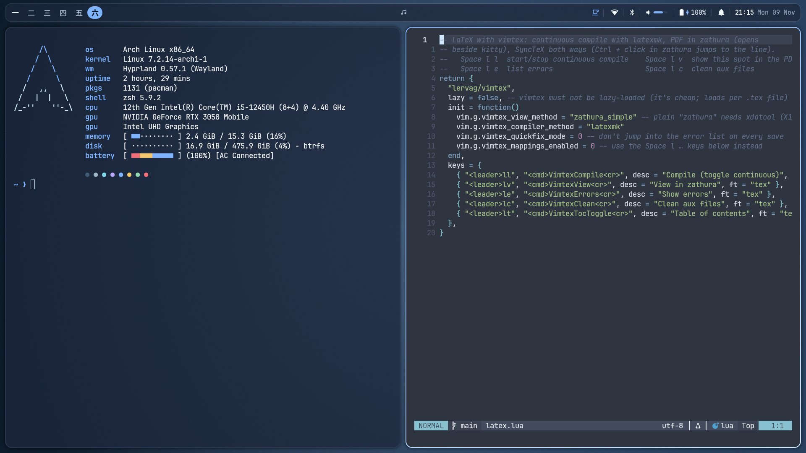
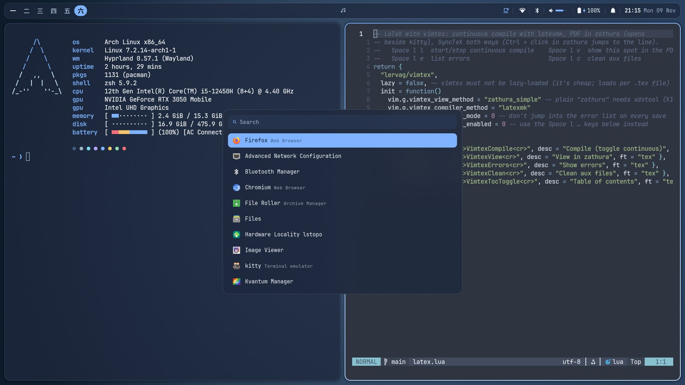
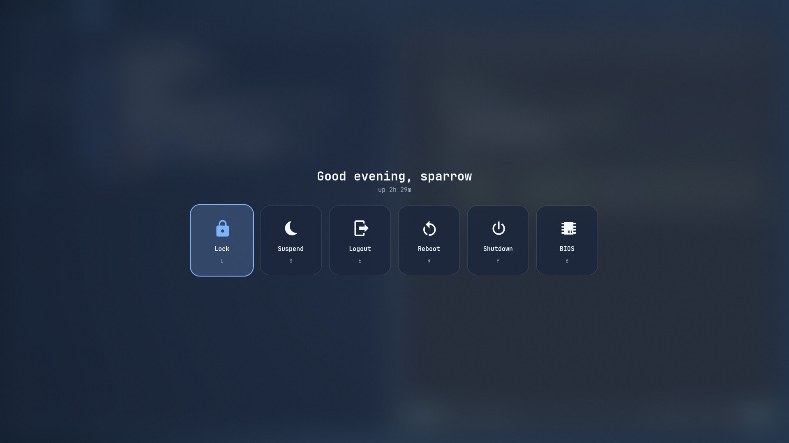

# dotfiles · Hyprland on Arch

A calm blue-and-white Hyprland desktop for an **HP Victus 15 laptop**
(Intel i5-12450H + **RTX 3050**, hybrid graphics) on Arch Linux. Bar, popups,
notifications, panels and overlays are all **Quickshell**. Everything is in this
repo and linked into place with GNU Stow; nothing is edited outside it by hand.



| App launcher (ALT + D) | Power menu (ALT + Escape) |
|---|---|
|  |  |

## What's in it

- **Hyprland 0.57** (Lua config) on the Intel iGPU; games and heavy apps on the
  RTX 3050 through `prime-run`. Smooth, no-bounce animations, sensible floating
  rules, tearing for games.
- **Quickshell bar**: workspaces 一 二 三 四 五 六, music with play/pause,
  tray, recording and stay-awake indicators, Wi-Fi / Bluetooth / audio menus
  that really connect, pair and switch devices, battery, notifications, clock
  + calendar.
- **Overlays**: on-screen volume/brightness, notification popups + center with
  Do Not Disturb (automatic during fullscreen games), system stats panel,
  power menu, wallpaper reel (slanted cards, angled transition), keybind
  cheat sheet, idle screen.
- **Lock + login**: [qylock](https://github.com/Darkkal44/qylock) "winter" for
  SDDM and the lock screen; hypridle dims → idle screen → locks → screen off,
  and suspends after 20 min **on battery only**. Closing the lid locks when
  plugged in and suspends on battery.
- **Rofi** launcher, clipboard history with image thumbnails, emoji picker.
- **Capture**: screenshots (frozen screen, annotate with satty), color picker,
  OCR, screen recording with a 60 s instant-replay buffer.
- **Themes**: one palette drives every app (Hyprland, Quickshell, rofi, kitty,
  starship, fzf, bat, lazygit, fastfetch, Qt, Vesktop, MangoHud). Switch with
  **ALT + T**: Blue Ice (default), Catppuccin Mocha / Macchiato / Frappé.
  Neovim, Nautilus and zathura stay Nord.
- **Shell**: kitty, zsh + Oh My Zsh, starship, eza, bat, ripgrep, fd, fzf,
  zoxide, lazygit, fastfetch, a dropdown terminal (ALT + `).
- **Neovim**: Nord, LSP, Telescope, Treesitter, LaTeX with live preview in
  zathura (SyncTeX both ways).
- **Apps**: Zen, Nautilus (with Google Drive via rclone), Outlook web app,
  Teams, Vesktop, Claude desktop, LocalSend, Steam + MangoHud + GameMode.
- **Safety net**: btrfs snapshots before/after every package change (snapper +
  snap-pac), a careful `update` command, firewall, and a maintenance log.

## Install (fresh Arch Linux)

Assumes Arch on **btrfs** with systemd-boot, NetworkManager and the AUR helper
`yay`, on this laptop's hardware. Other machines: read the GPU (§2) and
hardware notes in `system/ROOT-STEPS.md` first.

```sh
git clone https://github.com/sparrow876/dotfiles ~/dotfiles
cd ~/dotfiles
```

Then follow **[system/ROOT-STEPS.md](system/ROOT-STEPS.md)** from the top. Every
step that needs `sudo` is there, in order, with what it does and how to undo it.
Short version:

1. `bash system/root-steps/1-snapshots.sh`: snapper, snap-pac, snapshot limits.
2. `bash system/root-steps/1.5-home-subvolumes.sh` from a TTY (keeps caches,
   downloads, recordings and Steam out of snapshots).
3. `bash system/root-steps/2-nvidia.sh`, then **reboot**.
4. Install `yay` (ROOT-STEPS §5.0), then `bash system/root-steps/3-system.sh`:
   checks, performance profile, multilib, **all packages** (`packages/*.txt`),
   the user-level `./install.sh`, timers, firewall.
5. `./install.sh` again only if you skipped step 4 or changed something: the
   user-level part (no sudo): folders, default wallpaper, pinned clones (Oh My
   Zsh, plugins, qylock), theme files, stow links, Qt and GTK settings.
6. `chsh -s /usr/bin/zsh` (ROOT-STEPS §8).
7. Lock + login screen: qylock's two scripts, then
   `bash system/root-steps/4-login.sh` (ROOT-STEPS §10), and reboot into SDDM.
8. Laptop lid (lock when plugged in, suspend on battery): ROOT-STEPS §14.
9. Optional: Google Drive and folder colors (§11), work/chat apps (§12),
   gaming (§13 + [system/GAMING.md](system/GAMING.md)).

`./install.sh` (without `--packages`) never uses `sudo`, never edits `/etc` and
never runs third-party scripts. `./install.sh --help` lists its steps.

## Everyday use

- **ALT + /** shows every shortcut (searchable). The full table is below.
- **ALT + T** switches the theme. **ALT + W** picks a wallpaper (drop images in
  `~/Pictures/Wallpapers`).
- **`update`** in a terminal updates the system safely: Arch news first (stops
  if something needs a manual step), then `yay -Syu`, then checks. `update
  --check` changes nothing. See [zsh/SHELL-CHEATSHEET.md](zsh/SHELL-CHEATSHEET.md).
- Games: launch options `prime-run gamemoderun mangohud %command%`
  ([system/GAMING.md](system/GAMING.md)).

## Keybinds

Generated from the live Hyprland binds by `scripts/keybinds-to-md.sh README.md`
(the same source as the ALT + / cheat sheet). Modifier: **ALT**.

<!-- keybinds:start -->
<!-- generated by scripts/keybinds-to-md.sh; do not edit by hand -->

### Apps

| Keys | Action |
|------|--------|
| `ALT + Enter` | Terminal (kitty) |
| `ALT + D` | App launcher |
| `ALT + C` | Clipboard history |
| `ALT + SHIFT + E` | Emoji picker |
| `ALT + E` | Files (Nautilus) |
| `` ALT + ` `` | Dropdown terminal |

### Windows

| Keys | Action |
|------|--------|
| `ALT + Q` | Close window |
| `ALT + F` | Toggle fullscreen |
| `ALT + V` | Toggle floating |
| `ALT + Tab` | Next window on workspace |
| `ALT + SHIFT + Tab` | Previous window on workspace |
| `ALT + H` / `ALT + ←` | Focus left |
| `ALT + SHIFT + H` / `ALT + SHIFT + ←` | Move window left |
| `ALT + J` / `ALT + ↓` | Focus down |
| `ALT + SHIFT + J` / `ALT + SHIFT + ↓` | Move window down |
| `ALT + K` / `ALT + ↑` | Focus up |
| `ALT + SHIFT + K` / `ALT + SHIFT + ↑` | Move window up |
| `ALT + L` / `ALT + →` | Focus right |
| `ALT + SHIFT + L` / `ALT + SHIFT + →` | Move window right |
| `ALT + Left-drag` | Move with mouse (drag) |
| `ALT + Right-drag` | Resize with mouse (drag) |

### Workspaces

| Keys | Action |
|------|--------|
| `ALT + 1…6` | Go to workspace 1–6 |
| `ALT + SHIFT + 1…6` | Move window to workspace 1–6 |

### Capture

| Keys | Action |
|------|--------|
| `Print` | Screenshot of a region |
| `ALT + SHIFT + S` | Screenshot of a region (alternative) |
| `SHIFT + Print` | Screenshot of the whole screen |
| `ALT + Print` | Screenshot of the active window |
| `ALT + SHIFT + C` | Pick a color (hex copied) |
| `ALT + O` | Copy text from a screen region (OCR) |
| `ALT + R` | Start/stop screen recording |
| `ALT + SHIFT + R` | Start/stop recording a region |
| `ALT + CTRL + R` | Replay mode on / save last 60 s |
| `ALT + CTRL + SHIFT + R` | Replay mode on / off |

### System

| Keys | Action |
|------|--------|
| `ALT + I` | Toggle idle inhibitor (stay awake) |
| `ALT + N` | Notification center |
| `ALT + S` | System stats panel |
| `ALT + W` | Wallpaper selector |
| `ALT + T` | Theme selector |
| `ALT + /` | Keybind cheat sheet |
| `ALT + Esc` | Power menu |
| `SUPER + L` | Lock screen |

### Media

| Keys | Action |
|------|--------|
| `Volume Up` | Volume up |
| `Volume Down` | Volume down |
| `Mute key` | Mute |
| `Mic Mute key` | Mute microphone |
| `Play key` / `Pause key` | Play / pause |
| `Next key` | Next track |
| `Previous key` | Previous track |
| `Brightness Up` | Brightness up |
| `Brightness Down` | Brightness down |
<!-- keybinds:end -->

## Recovery

- **Hyprland won't start / black screen**: press **Ctrl + Alt + F3**, log in,
  then `cd ~/dotfiles` and run `claude`. Everything needed to diagnose works
  without a desktop (Wi-Fi from a TTY: `nmtui`).
- **Bar disappeared**: `pkill -x qs; hyprctl dispatch 'hl.dsp.exec_cmd("qs")'`
  (from a TTY add `-i 0`: `hyprctl -i 0 dispatch ...`).
- **Lock screen crashed or frozen** (red screen / can't type): press
  **Ctrl + Alt + F3**, log in, then
  `pkill -f 'quickshell-lockscreen/lock_shell\.qml'` and
  `hyprctl -i 0 dispatch 'hl.dsp.exec_cmd("~/dotfiles/scripts/lock.sh")'`.
  Go back with **Ctrl + Alt + F1** (or F2) and unlock. Last resort, losing
  unsaved work: `hyprctl -i 0 dispatch 'hl.dsp.exit()'`.
- **An update broke something**: every package change has a "pre" snapshot.
  `snapper -c root list` shows them (the `update` command prints the right
  number); how to roll back, in plain English: ROOT-STEPS §1.6.
- **Login screen broken**: from a TTY, `sudo systemctl disable sddm.service`,
  reboot, log in on the TTY and type `start-hyprland`.
- **No sound**: MAINTENANCE.md §4.4 (card profile).
- **Colors look wrong**: `theme/apply.sh blue-ice`.

More in [MAINTENANCE.md](MAINTENANCE.md) §8.

## Documentation

| File | What's in it |
|------|--------------|
| [system/ROOT-STEPS.md](system/ROOT-STEPS.md) | every root action, in order, with undo |
| [MAINTENANCE.md](MAINTENANCE.md) | how the system is built, gotchas, recipes, dated log of breakages and fixes |
| [zsh/SHELL-CHEATSHEET.md](zsh/SHELL-CHEATSHEET.md) | the shell and CLI tools, in plain English |
| [nvim/CHEATSHEET.md](nvim/CHEATSHEET.md) | Neovim + LaTeX, in plain English |
| [theme/README.md](theme/README.md) | palettes and how to add a theme |
| [system/GAMING.md](system/GAMING.md) | Steam, launch options, controller, per-game notes |
| [system/APPS.md](system/APPS.md) | Outlook, Teams, Vesktop, Claude, Google Drive, LocalSend |
| [lockscreen/README.md](lockscreen/README.md) | how the qylock lock/login screen is set up |

## Repository layout

```
hypr/ quickshell/ rofi/ kitty/ zsh/ starship/ fastfetch/ lazygit/ bat/
nvim/ zathura/ gtk/ qt/ xdg/ applications/ systemd/ vesktop/ mangohud/ gamemode/
                      stow packages: each mirrors $HOME (e.g. kitty/.config/kitty/)
theme/                palettes, style, templates, render.sh, apply.sh
scripts/              screenshot, OCR, recording, clipboard, lock, update, ...
packages/             pacman.txt, aur.txt (PKGBUILDs reviewed), base.txt
system/               ROOT-STEPS.md, root-step scripts, /etc snippets, units, docs
install.sh            user-level setup (stow, clones, theme, settings)
```

## Credits

Built on the work of many projects, each under its own license:
[Hyprland](https://hypr.land) and hypridle ·
[Quickshell](https://git.outfoxxed.me/quickshell/quickshell) ·
[qylock](https://github.com/Darkkal44/qylock) by Darkkal44 (lock and login
screen, GPL-3.0; cloned by `install.sh`, not included here) ·
[awww](https://codeberg.org/LGFae/awww) ·
[rofi](https://github.com/davatorium/rofi) + rofimoji ·
[kitty](https://sw.kovidgoyal.net/kitty/) ·
[Oh My Zsh](https://ohmyz.sh), zsh-autosuggestions, zsh-syntax-highlighting ·
starship, fastfetch, eza, bat, ripgrep, fd, fzf, zoxide, lazygit ·
[Neovim](https://neovim.io) with lazy.nvim, nord.nvim, Telescope, nvim-treesitter,
mason, blink.cmp, neo-tree, lualine, bufferline, which-key, gitsigns,
toggleterm, vimtex · zathura ·
grim, slurp, satty, hyprpicker, tesseract, gpu-screen-recorder, cliphist ·
MangoHud, GameMode · rclone ·
[Catppuccin](https://catppuccin.com) palettes (MIT) ·
[Nord](https://www.nordtheme.com) ·
Papirus icons · Bibata cursor · JetBrains Mono Nerd Font.

## License

[MIT](LICENSE), for the files in this repository. Third-party software it
installs or clones keeps its own license (qylock: GPL-3.0, not included here).
