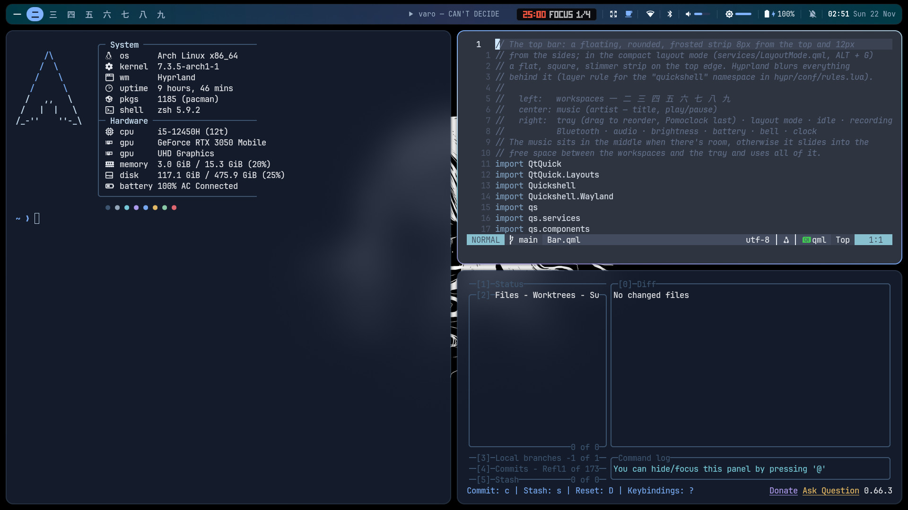
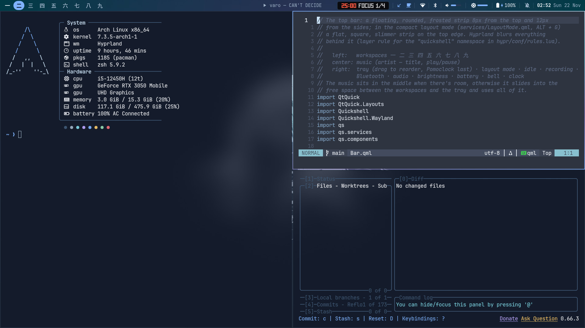
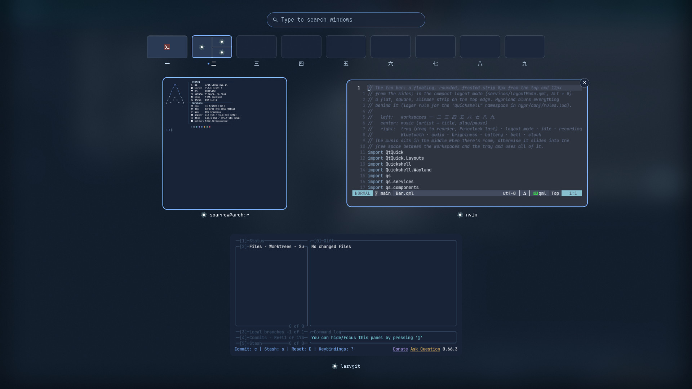
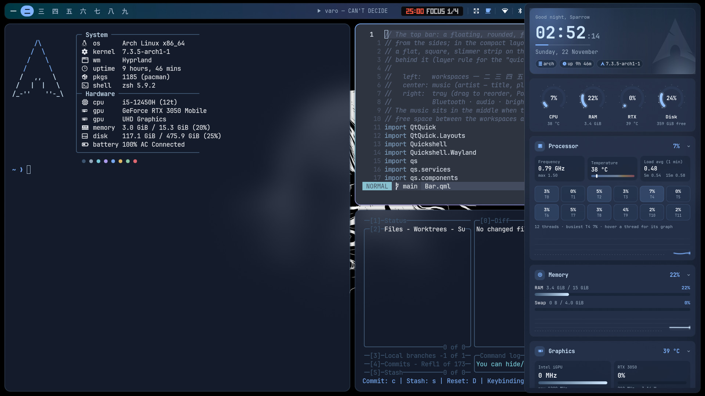
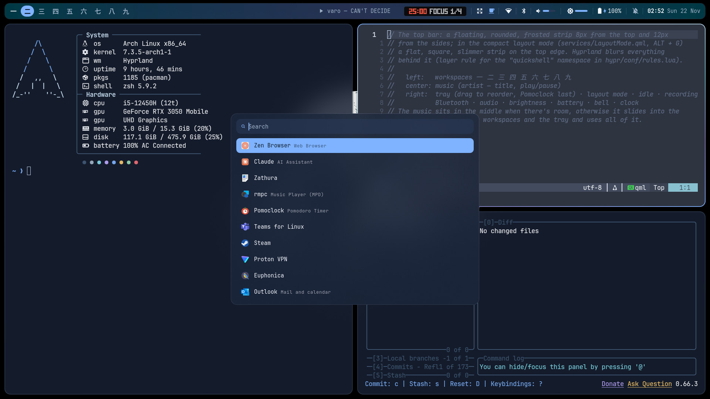
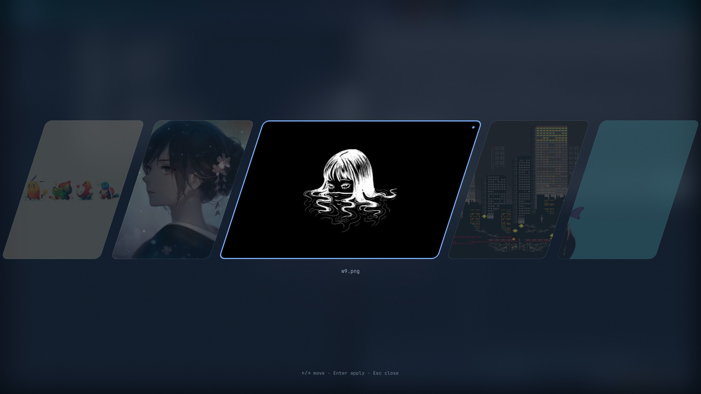
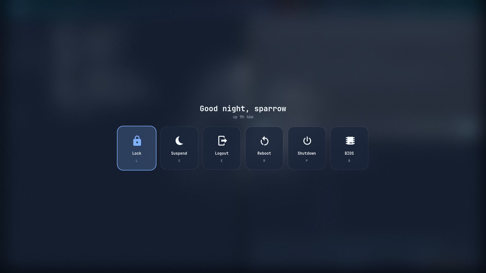

# dotfiles · Hyprland on Arch

A calm, blue Hyprland desktop for an **HP Victus 15 laptop** (Intel i5-12450H +
**RTX 3050**, hybrid graphics) on Arch Linux. The bar, popups, notifications,
panels, overview and every overlay are hand-written in **Quickshell**. All
config lives in this repo and is linked into place with GNU Stow.



| Compact layout (bar button or ALT + G) | Window overview (3-finger swipe up or ALT + A) |
|---|---|
|  |  |
| **System stats (ALT + S)** | **App launcher (ALT + D)** |
|  |  |
| **Wallpaper reel (ALT + W)** | **Power menu (ALT + Escape)** |
|  |  |

## The look

- **Blue Ice** everywhere: deep navy, steel blue, light blue and ice-white, in
  Hyprland, Quickshell, rofi, kitty, the prompt, fzf, bat, lazygit, fastfetch,
  Qt apps, qimgv, Vesktop and MangoHud. GTK apps use a teal accent. Neovim,
  Nautilus and zathura use Nord, a close cousin.
- **The bar** is a "deep glacier" gradient: teal at both ends, steel blue, and
  indigo in the middle, all at the same perceived brightness, so text stays
  easy to read everywhere.
- **Windows** get a soft aurora border (light blue → ice → cyan → a hint of
  lavender) that slowly drifts round once when a window opens or gets focus,
  and is still otherwise.
  Unfocused windows are dimmed slightly.
- **Two layouts**, switched with an animation: *spaced* (floating rounded
  bar, gaps, rounded windows, shadows) or *compact* (i3-style: no gaps, square
  windows, the bar a flat strip on the top edge).
- **Motion** is smooth and calm: things glide and settle, nothing bounces.
  Nothing animates while you're not doing anything, so idle CPU stays near
  zero.

## What's in it

**Desktop**
- **Hyprland 0.57** (Lua config) on the Intel iGPU; games and heavy apps on the
  RTX 3050 through `prime-run`. 9 workspaces (一 … 九), 3-finger swipe
  left/right between them, sensible floating rules, tearing for games.
- **Window overview** (3-finger swipe up or **ALT + A**): every open window,
  on every workspace, as live thumbnails in one grid with its workspace badge;
  the 9 workspaces as mini-maps above (click one to go there, drop a window on
  one to move it). Type to filter. Swipe down or Esc closes.

**Bar** (Quickshell)
- Workspaces with a sliding pill; the music in the middle (**click**:
  play/pause, **middle-click**: a now-playing card with the cover, seek bar and
  controls; a long title scrolls on hover).
- On the right: the tray (drag icons to reorder; the order is remembered),
  the layout button, stay-awake (coffee cup), recording indicator, Wi-Fi,
  Bluetooth and audio menus that really connect, pair and switch devices,
  brightness (scroll, or click for a slider with presets), battery,
  notifications and the clock with a calendar.

**Overlays and panels**
- On-screen volume / brightness indicator, notification popups and a
  notification center with Do Not Disturb (automatic during fullscreen games).
- **System stats (ALT + S)**: CPU/RAM/GPU/disk gauges, a per-thread heat map
  (hover a thread for its own graph), smooth graphs, GPUs, storage, network,
  battery health, and top processes with app icons (end one with a confirm).
- Power menu, wallpaper reel (looping slanted cards over a blurred preview;
  the chosen card grows to fill the screen, then a slanted wipe reveals the
  desktop), keybind cheat
  sheet (**ALT + /**, searchable), idle screen.

**Lock, login and idle**
- [qylock](https://github.com/Darkkal44/qylock) "winter" for the SDDM login
  and the lock screen (**SUPER + L**), with a small patch to its login code
  (no hang on an empty password; it says why a login failed).
- Idle: dim + idle screen → lock → screen off; suspend after 20 min **on
  battery only**. Closing the lid locks when plugged in and suspends on
  battery.

**Launcher and tools**
- **rofi**: app launcher (**ALT + D**), clipboard history with image
  thumbnails (**ALT + C**), emoji picker (**ALT + SHIFT + E**), calculator
  (**ALT + =**, also units and currencies; Enter copies), and a file finder for
  your home folder (**ALT + SHIFT + F**, newest first; Enter opens, Shift +
  Enter shows it in Nautilus).
- **Capture**: screenshots on a frozen screen (annotate with satty), color
  picker, OCR, **LaTeX OCR** (an equation on screen → LaTeX code, offline with
  pix2tex, ~1 s once loaded), screen recording with a 60-second instant-replay
  buffer.

**Terminal and shell**
- kitty, zsh + Oh My Zsh, starship, eza, bat, ripgrep, fd, fzf, zoxide,
  lazygit, fastfetch (boxed, with icons), a dropdown terminal (**ALT + `**).
- `lockdir` / `unlockdir` to password-protect a folder (GnuPG AES-256),
  `view-all-images` (a folder and its subfolders in one image grid),
  `ccmonitor` (live Claude Code usage and limits), `update` (safe system
  updates, below).

**Neovim**
- Nord, LSP, Telescope, Treesitter, completion, file tree, git signs, lazygit.
- **Space c f** formats the file (C/C++, LaTeX, Rust, Python; Rust also on
  save); brackets and `$…$` (in LaTeX) close themselves without getting in the
  way.
- LaTeX with live preview in zathura (SyncTeX both ways), Rust with
  rust-analyzer and clippy.

**Files and apps**
- **Nautilus**: Nord, Google Drive via rclone, PDF thumbnails, right-click
  **Copy as Path**, **View All Images** and **Lock with Password… / Unlock…**.
  Images open in **qimgv**.
- **Music**: rmpc (terminal player with album art and a visualiser) on MPD,
  shown in the bar and on the media keys.
- Zen, Outlook web app, Teams, Vesktop, Claude desktop, LocalSend; Steam +
  MangoHud + GameMode (GE-Proton where a game needs it).

**Safety net**
- btrfs snapshots before and after every package change (snapper + snap-pac),
  a careful `update` command, a firewall, and a dated maintenance log.

## Install (fresh Arch Linux)

Assumes Arch on **btrfs** with systemd-boot and NetworkManager, on this
laptop's hardware. On other machines, read the GPU and hardware notes in
`system/ROOT-STEPS.md` first.

```sh
git clone https://github.com/sparrow876/dotfiles ~/dotfiles
cd ~/dotfiles
```

Then follow **[system/ROOT-STEPS.md](system/ROOT-STEPS.md)** from the top. Every
step that needs `sudo` is there, in order, with what it does and how to undo it.
Short version:

1. `bash system/root-steps/1-snapshots.sh`: snapper, snap-pac, snapshot limits.
2. `bash system/root-steps/1.5-home-subvolumes.sh` from a TTY (keeps caches,
   downloads, recordings and Steam out of snapshots).
3. `bash system/root-steps/2-nvidia.sh`, then **reboot**.
4. Install the AUR helper `yay` (ROOT-STEPS §5.0), then
   `bash system/root-steps/3-system.sh`: checks, performance profile,
   multilib, **all packages** (`packages/*.txt`), the user-level
   `./install.sh`, timers, firewall.
5. `./install.sh` again only if you skipped step 4 or changed something. It's
   the user-level part (no sudo): folders, default wallpaper, pinned clones
   (Oh My Zsh, plugins, qylock), stow links, Qt and GTK settings.
6. `chsh -s /usr/bin/zsh` (ROOT-STEPS §8).
7. Lock + login screen: qylock's two scripts, then
   `bash system/root-steps/4-login.sh` (ROOT-STEPS §10), and reboot into SDDM.
8. Laptop lid (lock when plugged in, suspend on battery): ROOT-STEPS §14.
9. Move to Trash in Downloads / Recordings / .cache / Steam:
   `bash system/root-steps/5-trash-mounts.sh` (ROOT-STEPS §15).
10. Music (rmpc on MPD, the bar's music widget, media keys): install
    `mpdris2-rs` from the AUR and enable the two user services (ROOT-STEPS §16).
11. Optional: Google Drive and folder colours (§11), work/chat apps (§12),
    gaming (§13 + [system/GAMING.md](system/GAMING.md)), Rust
    (`./install.sh --only rust` after `rustup`), LaTeX OCR
    (`scripts/latex-ocr/setup.sh`), ccmonitor (`scripts/ccmonitor/setup.sh`).

`./install.sh` (without `--packages`) never uses `sudo`, never edits `/etc` and
never runs third-party scripts; `./install.sh --help` lists its steps. Every
AUR package was reviewed first (`packages/aur.txt` notes the reviewed AUR
commit), and the two Python tools install only checksum-pinned packages (their
`requirements.txt`).

## Everyday use

- **ALT + /** shows every shortcut, searchable; the full table is below.
- **3-finger swipe up** (or **ALT + A**) shows all windows; swipe down closes.
- **ALT + G** (or the bar button left of the coffee cup) switches between the
  spaced and compact layouts. The choice is remembered.
- **ALT + W** picks a wallpaper (put images in `~/Pictures/Wallpapers`; they're
  listed in natural order: w1, w2, …, w10, and the reel loops round). ←/→,
  scroll or click to move, Enter to apply, Esc to close.
- **Bar**: drag tray icons to reorder them; scroll on the sun for brightness;
  middle-click the music for the now-playing card.
- **`update`** in a terminal updates the system safely: Arch news first (it
  stops if something needs a manual step), then `yay -Syu`, then checks.
  `update --check` changes nothing. See
  [zsh/SHELL-CHEATSHEET.md](zsh/SHELL-CHEATSHEET.md).
- Games: launch options `prime-run gamemoderun mangohud %command%`
  ([system/GAMING.md](system/GAMING.md)).

## Keybinds

Generated from the live Hyprland binds by `scripts/keybinds-to-md.sh README.md`
(the same source as the ALT + / cheat sheet). Modifier: **ALT**.

<!-- keybinds:start -->
<!-- generated by scripts/keybinds-to-md.sh; do not edit by hand -->

### Apps

| Keys | Action |
|------|--------|
| `ALT + Enter` | Terminal (kitty) |
| `ALT + D` | App launcher |
| `ALT + C` | Clipboard history |
| `ALT + SHIFT + E` | Emoji picker |
| `ALT + E` | Files (Nautilus) |
| `ALT + =` | Calculator |
| `ALT + SHIFT + F` | Find a file in your home folder |
| `` ALT + ` `` | Dropdown terminal |

### Windows

| Keys | Action |
|------|--------|
| `ALT + A` | Overview of all windows (also 3-finger swipe up) |
| `ALT + Q` | Close window |
| `ALT + F` | Toggle fullscreen |
| `ALT + V` | Toggle floating |
| `ALT + Tab` | Next window on workspace |
| `ALT + SHIFT + Tab` | Previous window on workspace |
| `ALT + H` / `ALT + ←` | Focus left |
| `ALT + SHIFT + H` / `ALT + SHIFT + ←` | Move window left |
| `ALT + J` / `ALT + ↓` | Focus down |
| `ALT + SHIFT + J` / `ALT + SHIFT + ↓` | Move window down |
| `ALT + K` / `ALT + ↑` | Focus up |
| `ALT + SHIFT + K` / `ALT + SHIFT + ↑` | Move window up |
| `ALT + L` / `ALT + →` | Focus right |
| `ALT + SHIFT + L` / `ALT + SHIFT + →` | Move window right |
| `ALT + Left-drag` | Move with mouse (drag) |
| `ALT + Right-drag` | Resize with mouse (drag) |

### System

| Keys | Action |
|------|--------|
| `ALT + G` | Toggle layout (spaced / compact, no gaps) |
| `ALT + I` | Toggle idle inhibitor (stay awake) |
| `ALT + N` | Notification center |
| `ALT + S` | System stats panel |
| `ALT + W` | Wallpaper selector |
| `ALT + /` | Keybind cheat sheet |
| `ALT + Esc` | Power menu |
| `SUPER + L` | Lock screen |

### Workspaces

| Keys | Action |
|------|--------|
| `ALT + 1…9` | Go to workspace 1–9 |
| `ALT + SHIFT + 1…9` | Move window to workspace 1–9 |

### Capture

| Keys | Action |
|------|--------|
| `Print` | Screenshot of a region |
| `ALT + SHIFT + S` | Screenshot of a region (alternative) |
| `SHIFT + Print` | Screenshot of the whole screen |
| `ALT + Print` | Screenshot of the active window |
| `ALT + SHIFT + C` | Pick a color (hex copied) |
| `ALT + O` | Copy text from a screen region (OCR) |
| `ALT + SHIFT + O` | Copy an equation as LaTeX (LaTeX OCR) |
| `ALT + R` | Start/stop screen recording |
| `ALT + SHIFT + R` | Start/stop recording a region |
| `ALT + CTRL + R` | Replay mode on / save last 60 s |
| `ALT + CTRL + SHIFT + R` | Replay mode on / off |

### Media

| Keys | Action |
|------|--------|
| `Volume Up` | Volume up |
| `Volume Down` | Volume down |
| `Mute key` | Mute |
| `Mic Mute key` | Mute microphone |
| `Play key` / `Pause key` | Play / pause |
| `Next key` | Next track |
| `Previous key` | Previous track |
| `Brightness Up` | Brightness up |
| `Brightness Down` | Brightness down |
<!-- keybinds:end -->

## Recovery

- **Hyprland won't start / black screen**: press **Ctrl + Alt + F3**, log in,
  then `cd ~/dotfiles` and run `claude`. Everything needed to diagnose works
  without a desktop (Wi-Fi from a TTY: `nmtui`).
- **Bar disappeared**: `pkill -x qs; hyprctl dispatch 'hl.dsp.exec_cmd("qs")'`
  (from a TTY add `-i 0`: `hyprctl -i 0 dispatch ...`).
- **Lock screen crashed or frozen** (red screen / can't type): press
  **Ctrl + Alt + F3**, log in, then
  `pkill -f 'quickshell-lockscreen/lock_shell\.qml'` and
  `hyprctl -i 0 dispatch 'hl.dsp.exec_cmd("~/dotfiles/scripts/lock.sh")'`.
  Go back with **Ctrl + Alt + F1** (or F2) and unlock. Last resort, losing
  unsaved work: `hyprctl -i 0 dispatch 'hl.dsp.exit()'`.
- **An update broke something**: every package change has a "pre" snapshot.
  `snapper -c root list` shows them (the `update` command prints the right
  number); how to roll back, in plain English: ROOT-STEPS §1.6.
- **Login screen broken**: from a TTY, `sudo systemctl disable sddm.service`,
  reboot, log in on the TTY and type `start-hyprland`.
- **Stuck in the compact layout or odd gaps**: `scripts/layout-mode.sh spaced`.
- **No sound**: MAINTENANCE.md §4.4 (card profile).
- **Qt apps or qimgv lost their colours**: `./install.sh --only qt`.

More in [MAINTENANCE.md](MAINTENANCE.md) §8.

## Documentation

| File | What's in it |
|------|--------------|
| [system/ROOT-STEPS.md](system/ROOT-STEPS.md) | every root action, in order, with undo |
| [MAINTENANCE.md](MAINTENANCE.md) | how the system is built, gotchas, recipes, decisions, and a dated log of every change and fix |
| [zsh/SHELL-CHEATSHEET.md](zsh/SHELL-CHEATSHEET.md) | the shell and CLI tools, in plain English |
| [nvim/CHEATSHEET.md](nvim/CHEATSHEET.md) | Neovim + LaTeX, in plain English |
| [system/GAMING.md](system/GAMING.md) | Steam, launch options, controller, per-game notes |
| [system/APPS.md](system/APPS.md) | Outlook, Teams, Vesktop, Claude, Google Drive, LocalSend |
| [lockscreen/README.md](lockscreen/README.md) | how the qylock lock/login screen is set up, and its patch |

## Repository layout

```
hypr/ quickshell/ rofi/ kitty/ zsh/ starship/ fastfetch/ lazygit/ bat/ nvim/
zathura/ gtk/ qt/ xdg/ applications/ systemd/ vesktop/ mangohud/ gamemode/
thumbnailers/ nautilus/ bin/ mpd/ rmpc/ makepkg/
                      stow packages: each mirrors $HOME (e.g. kitty/.config/kitty/)
quickshell/.config/quickshell/
    bar/ popups/ notifications/ osd/ overview/ panel/ powermenu/ wallpaper/
    idle/ cheatsheet/ services/ components/      the whole shell, one folder per part
qimgv/                qimgv's colours (copied into place: qimgv rewrites its file)
lockscreen/           qylock notes + GPL patch for its login code
scripts/              screenshot, OCR, LaTeX OCR, recording, clipboard, calculator,
                      file finder, layout mode, lock, update, ...
packages/             pacman.txt, aur.txt (PKGBUILDs reviewed), base.txt
system/               ROOT-STEPS.md, root-step scripts, /etc snippets, units, docs
docs/screenshots/     the pictures above
install.sh            user-level setup (stow, clones, settings)
```

## Credits

Built on the work of many projects, each under its own license:
[Hyprland](https://hypr.land) and hypridle ·
[Quickshell](https://git.outfoxxed.me/quickshell/quickshell) ·
[qylock](https://github.com/Darkkal44/qylock) by Darkkal44 (lock and login
screen, GPL-3.0; cloned by `install.sh`, not included here) ·
[awww](https://codeberg.org/LGFae/awww) ·
[rofi](https://github.com/davatorium/rofi), rofimoji, rofi-calc + libqalculate ·
[kitty](https://sw.kovidgoyal.net/kitty/) ·
[Oh My Zsh](https://ohmyz.sh), zsh-autosuggestions, zsh-syntax-highlighting ·
starship, fastfetch, eza, bat, ripgrep, fd, fzf, zoxide, lazygit ·
[Neovim](https://neovim.io) with lazy.nvim, nord.nvim, Telescope,
nvim-treesitter, mason, blink.cmp, conform.nvim, nvim-autopairs, neo-tree,
lualine, bufferline, which-key, gitsigns, toggleterm, vimtex · zathura ·
grim, slurp, satty, hyprpicker, tesseract,
[pix2tex](https://github.com/lukas-blecher/LaTeX-OCR), gpu-screen-recorder,
cliphist · MPD, rmpc · qimgv ·
[Claude Code Usage Monitor](https://github.com/Maciek-roboblog/Claude-Code-Usage-Monitor) ·
MangoHud, GameMode, GE-Proton · rclone · blueman · nautilus-python · GnuPG ·
[Nord](https://www.nordtheme.com) · Papirus icons · Bibata cursor ·
JetBrains Mono Nerd Font.

## License

[MIT](LICENSE), for the files in this repository. Third-party software it
installs or clones keeps its own license (qylock: GPL-3.0, not included here).
